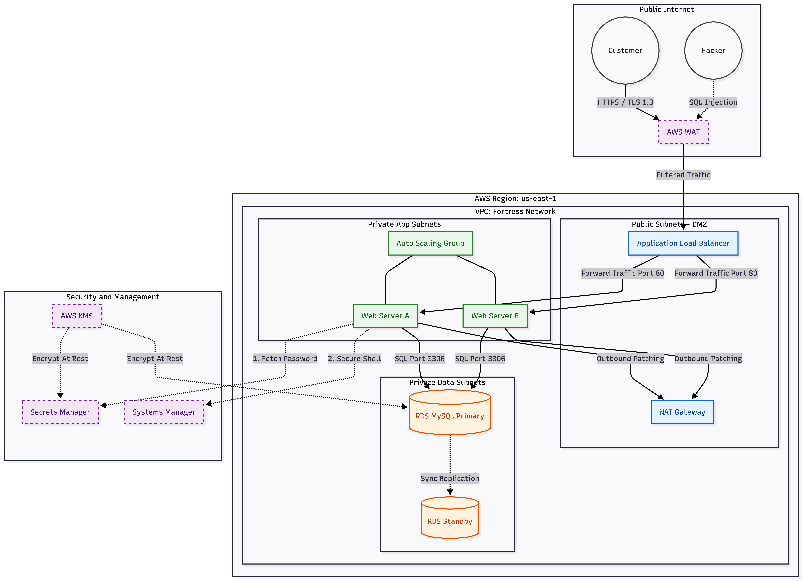
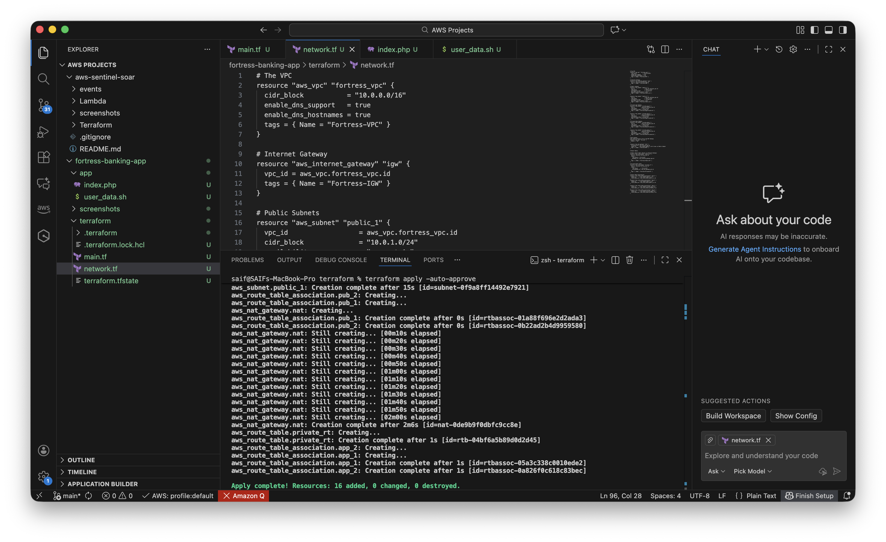
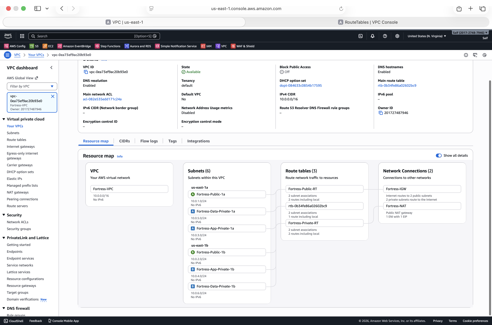
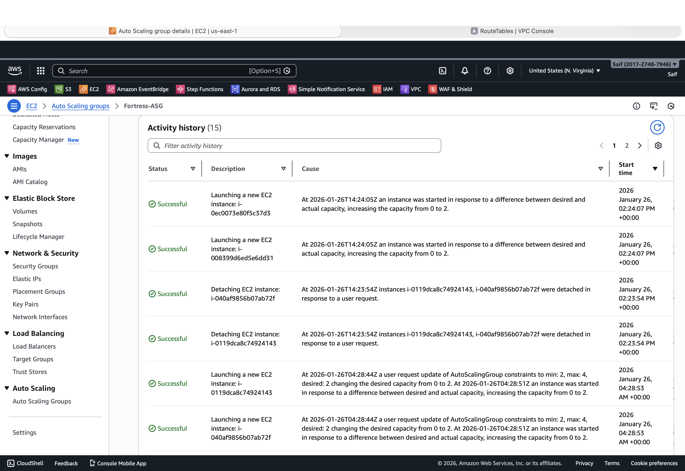
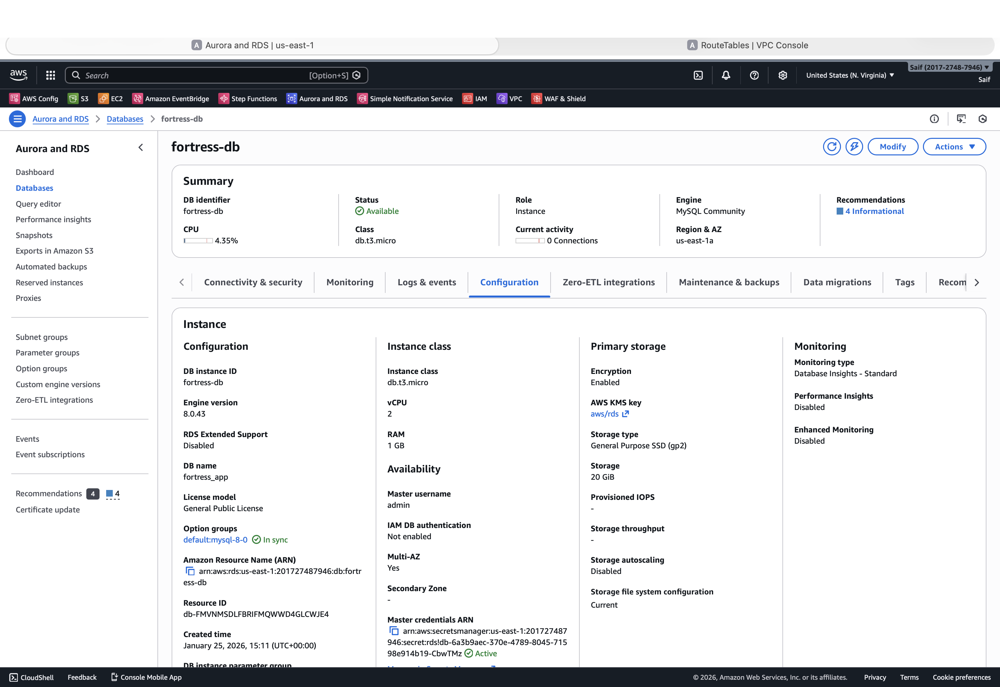
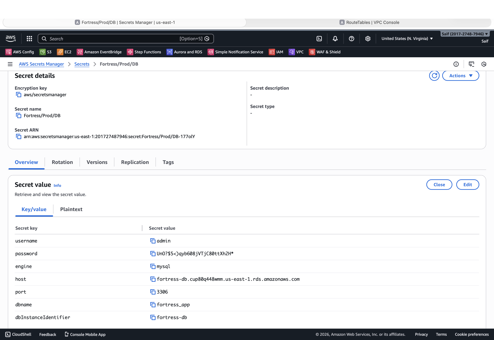
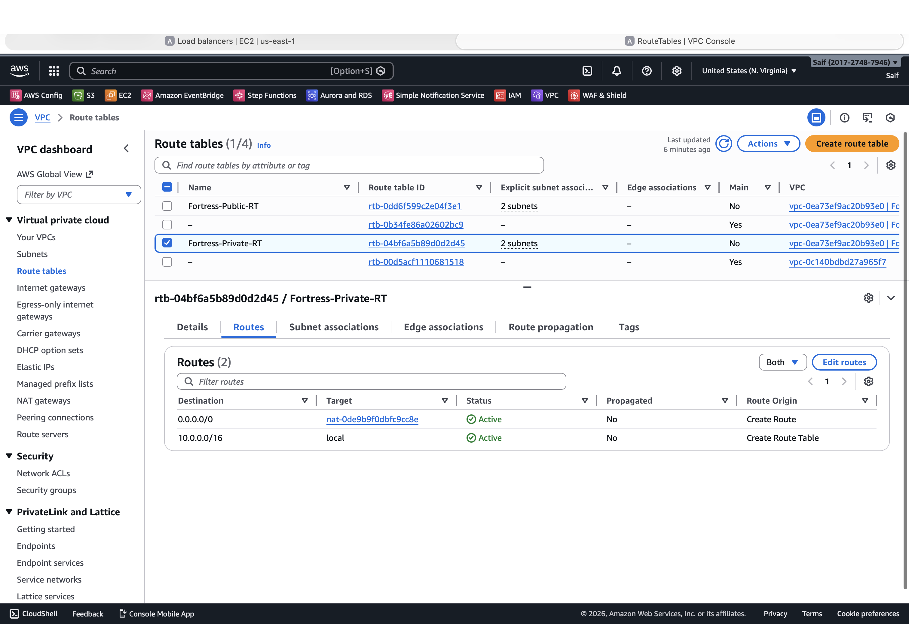
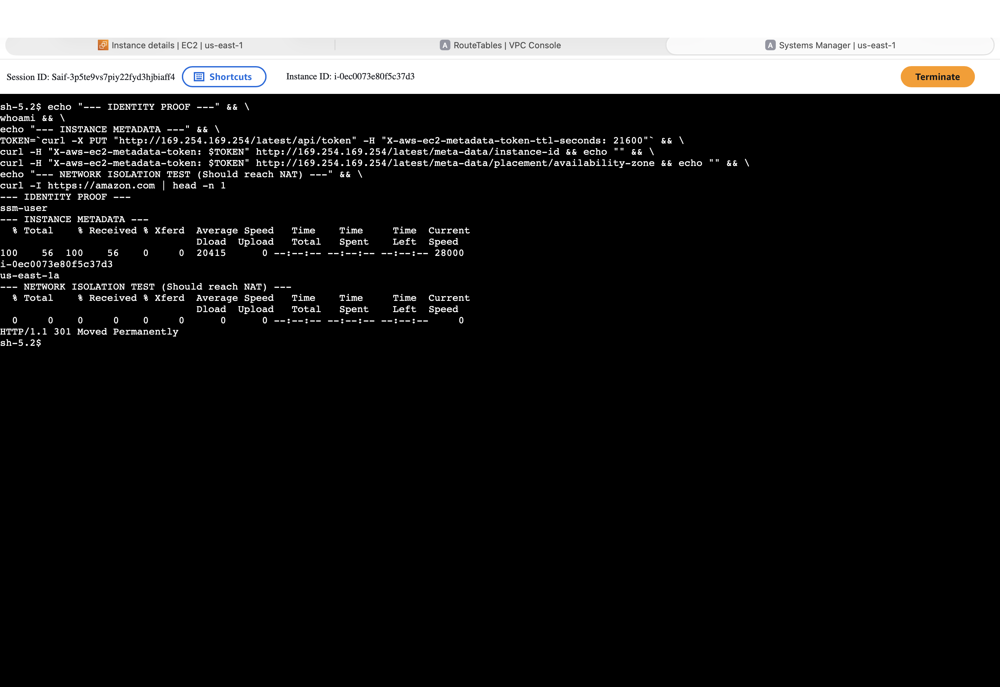
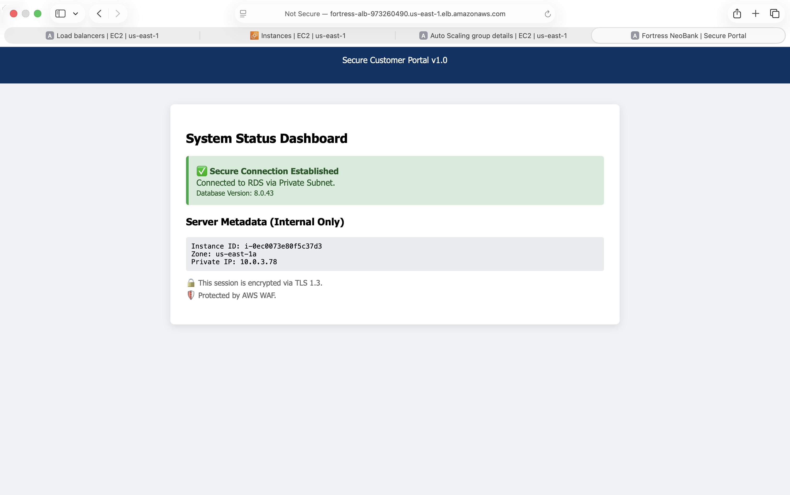

# Fortress: Building and Securing a 3-Tier Banking Architecture using Terraform on AWS

[](https://aws.amazon.com/architecture/)
[](https://www.terraform.io/)
[]()
[]()

## Executive Summary
In the financial sector, availability and data sovereignty are critical. **Fortress** is a production-ready **3-Tier Web Architecture** designed to host sensitive financial applications with **99.99% Availability** and **Zero-Trust Security**.

Unlike standard web setups, this project implements a "Hostile Network" strategy: eliminating SSH access, enforcing strict network isolation (Air Gapped Data Layer), and automating credential rotation to comply with **PCI-DSS Requirement 1.3** and **NIST 800-53**.

## 🏛️ Architectural Blueprint

The system utilizes a **Hub-and-Spoke Network Model** across two Availability Zones for maximum resilience.



### **The Request Lifecycle (Traffic Flow)**
1.  **Ingress:** User HTTPS traffic hits **AWS WAF** (Edge), filtering SQL Injection attacks.
2.  **Routing:** Valid traffic reaches the **Application Load Balancer (ALB)** in the Public Subnet (DMZ).
3.  **Processing:** ALB forwards requests to **EC2 Web Servers** in the Private App Subnet. *These servers have NO public IPs.*
4.  **Storage:** Web Servers connect to **RDS Multi-AZ Database** in the Private Data Subnet via Port 3306.
5.  **Security:** Servers fetch DB credentials dynamically from **Secrets Manager** at runtime (No hardcoded secrets).


## 🛡️ Security & Compliance Strategy

This architecture was engineered to satisfy strict regulatory controls found in UK Financial Services.

| Security Layer | Implementation | Compliance Mapping |
| :--- | :--- | :--- |
| **Edge Defense** | **AWS WAF** blocks SQL Injection (SQLi) and XSS attacks. | **OWASP Top 10** |
| **Network Isolation** | Web Servers live in **Private Subnets**. Database lives in **Isolated Data Subnets** (No Internet Route). | **PCI-DSS 1.3** |
| **Zero Trust Access** | SSH (Port 22) is blocked. Admin access is via **Systems Manager (SSM)**. | **NIST AC-4** |
| **Data Protection** | Database credentials rotated automatically via **Secrets Manager**. EBS/RDS encrypted via **KMS**. | **GDPR Art. 32** |


## 📸 Evidence of Execution 

This section documents the end-to-end deployment, validating the architecture from the Infrastructure layer up to the Application layer.

### **Phase 1: The Foundation (Infrastructure as Code)**
*Terraform Plan execution showing the creation of 16 network resources (VPC, Subnets, Gateways) in a single run, establishing the core topology.*


### **Phase 2: Network Topology (VPC Resource Map)**
*The final VPC layout visualizing the strict segmentation between Public (DMZ), Private (App), and Isolated (Data) subnets.*


---

### 🔻 Component Deep Dive (Click to Expand)

<details>
<summary><strong>🚀 Phase 3: Compute & Data Layer</strong></summary>

<br>

**Auto Scaling Fleet:** The system self-healing after a manual termination event, maintaining the desired capacity of 2 instances.


**Data Vault (RDS):** Multi-AZ MySQL instance running in the private "Data Vault" subnet with no public access.


**Secrets Management:** Automated credential rotation configuration for the database password (Zero hardcoded secrets).


</details>

<br>

<details>
<summary><strong>🛡️ Phase 4: Security & Access Control</strong></summary>

<br>

**Edge Defense (WAF):** AWS WAF actively blocking a simulated SQL Injection attack (403 Forbidden).


**Network Isolation:** Routing table confirming Private Subnets have NO route to the Internet Gateway (The Air Gap).


**Zero-Trust Access:** Secure, audit-logged shell access via Session Manager without SSH keys or open ports.


</details>

---

### **Phase 5: The Final Result (Secure Application)**
*The banking portal successfully connecting to the isolated database using rotated credentials, served securely via the Public Load Balancer.*



---

## Operational Playbook

This playbook defines the standard operating procedures (SOPs) for maintaining system health and responding to incidents.

### **Scenario A: Automated Failover (Resilience)**
* **Trigger:** An Availability Zone (e.g., `us-east-1a`) experiences a hardware failure or network partition.
* **System Response:**
    1.  **Database:** RDS automatically fails over to the Standby instance in `us-east-1b`. The DNS endpoint updates to point to the new Primary.
    2.  **Compute:** The Auto Scaling Group detects unhealthy instances (via ALB Health Checks) and launches replacements in the healthy zone.
* **RTO (Recovery Time Objective):** < 60 seconds (Database DNS propagation).
* **RPO (Recovery Point Objective):** ~0 seconds (Synchronous Replication).

### **Scenario B: Credential Rotation (Security)**
* **Trigger:** Security team initiates a rotation event in Secrets Manager (or scheduled 30-day rotation).
* **System Response:**
    1.  Secrets Manager invokes a Lambda rotator to generate a new password.
    2.  The rotator updates the RDS Database credential immediately.
    3.  New instances launched by Auto Scaling automatically fetch the new secret via API.
    4.  **Note:** Existing PHP sessions may require a graceful reload (e.g., `systemctl reload httpd`) if connection pooling is not implemented.

### **Scenario C: Zero-Day Patching**
* **Trigger:** A critical CVE is announced for the web server OS.
* **Response:**
    1.  Update the **Launch Template** with the latest patched AMI ID.
    2.  Initiate an **Instance Refresh** in the Auto Scaling Group.
    3.  ASG performs a rolling update, replacing old instances with patched ones with zero downtime.

---

## 💻 Tech Stack & Implementation

This architecture leverages a **Cloud-Native** approach, prioritizing managed services to reduce operational overhead.

* **Infrastructure as Code:** Terraform (State Management, VPC Module)
* **Compute:** Auto Scaling Groups (Amazon Linux 2023)
* **Configuration Management:** Bash User Data (Dynamic Credential Injection)
* **Network Security:** AWS WAF (Managed Ruleset), Security Group Chaining
* **Identity:** IAM Roles (Least Privilege), Systems Manager (Session Manager)
* **Data Persistence:** Amazon RDS (MySQL Multi-AZ), Secrets Manager


---

## 🛠️ Deployment Instructions

The project is designed for rapid hydration via Terraform.

**Prerequisites:**
* AWS CLI configured with Admin credentials.
* Terraform v1.5+ installed.

```bash
git clone [https://github.com/saif4224/AWS-Projects.git](https://github.com/saif4224/AWS-Projects.git) # Clone & Initialize
cd AWS-Projects/fortress-banking-app/terraform
terraform init
terraform apply -auto-approve # Deploy Network Foundation
```

**Application Hydration (Post-Terraform)**

Because this project demonstrates hybrid skills ("ClickOps" + Code), the Application Layer is deployed manually to demonstrate architectural understanding:

**Database**: Deploy RDS MySQL in Private Data Subnets.

**App Server**: Launch EC2 instances in Private App Subnets using the User Data script found in app/user_data.sh.

**Traffic**: Configure the Application Load Balancer in Public Subnets.
`

---

## FinOps & Cost Analysis

This architecture prioritizes resilience, which incurs specific costs. Below is the estimated Total Cost of Ownership (TCO) for running this stack in `us-east-1`.

| Resource | Service | Monthly Estimate | Cost Driver |
| :--- | :--- | :--- | :--- |
| **Network** | NAT Gateway | ~$32.00 | Hourly charge + Data processing ($0.045/GB). |
| **Traffic** | Application Load Balancer | ~$16.00 | Hourly charge + LCU (Load Balancer Capacity Units). |
| **Security** | AWS WAF | ~$5.00 | Flat fee per Web ACL + Request volume. |
| **Database** | RDS MySQL (Multi-AZ) | ~$26.00 | Instance hours (x2 for Multi-AZ) + Storage. |
| **Compute** | EC2 (t3.micro) | ~$8.00 | On-Demand rate (Free Tier eligible for first 12 months). |
| **Secrets** | Secrets Manager | ~$0.40 | Per secret per month + API calls. |
| **Total** | **Production Estimate** | **~$87.40 / mo** | *Cost can be reduced by 60% using Spot Instances for App Layer.* |

**Optimization Strategy:**
1.  **Spot Instances:** Configure ASG Mixed Instances Policy to use Spot for 70% of traffic.
2.  **Savings Plans:** Commit to 1-year Compute Savings Plan for stable baseline usage.
3.  **VPC Endpoints:** Replace NAT Gateway with VPC Endpoints for S3/DynamoDB to reduce data processing fees.


---

## 👨‍💻 About the Author
**KHANDAKER SAIFUZZAMAN**

**Aspirant Cloud Security Engineer | AWS Certified Solutions Architect - Associate** 

**CompTIA Security+ Certified** | **MSc Cybersecurity (United Kingdom)**

I specialize in designing **Financial-Grade Cloud Infrastructure** that balances agility with Zero-Trust security principles. This project demonstrates my ability to engineer compliant, self-healing systems suitable for highly regulated industries.

[Connect on LinkedIn](https://www.linkedin.com/in/khandakersaifuzzaman) 

## 🧠 Challenges & Lessons Learned
* **Kubernetes Networking Constraints:** Isolating the banking microservices required complex Calico network policies. I initially blocked all egress traffic, which broke the DNS resolution for internal services. I learned how to properly scope egress rules to strictly allow core DNS while blocking malicious outbound connections.
* **HashiCorp Vault Integration:** Injecting secrets dynamically into EKS pods without exposing them in environment variables was highly challenging. I overcame this by utilizing the Vault Agent Injector to write secrets directly to in-memory volumes, drastically improving the application's security posture.
